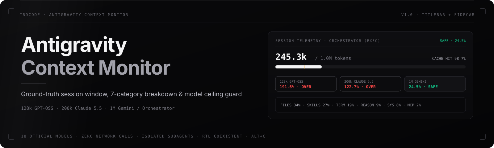
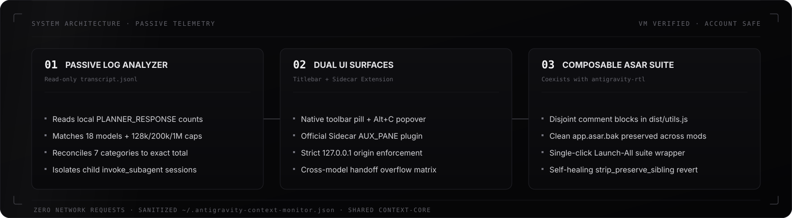

<p align="center">
  <a href="README.md">English</a> · <a href="README.zh-CN.md">简体中文</a> · <a href="README.ja.md">日本語</a> · <strong>Español</strong> · <a href="README.fa.md">فارسی</a> · <a href="https://irdcode.github.io/antigravity-context-monitor/">Docs Page</a>
</p>

<p align="center">
  
</p>

# Antigravity Context Monitor

**Monitor en tiempo real de ventana de contexto, desglose de tokens en 7 categorías, telemetría de caché, seguimiento de subagentes aislados y guardia de cambio entre modelos para Google Antigravity Desktop.**

Google Antigravity ejecuta subagentes aislados (`invoke_subagent`) y alterna modelos entre fases en el modo `Orchestrator`, ocultando el medidor de tokens en la interfaz. Sin embargo, guarda el conteo exacto por turno (`input_tokens`, `cache_read_tokens`, `output_tokens`) en `~/.gemini/antigravity/brain/<convId>/.system_generated/logs/transcript.jsonl`.

**`antigravity-context-monitor`** lee únicamente esos archivos locales de forma pasiva y sin llamadas de red, manteniendo tu cuenta 100% segura.

<p align="center">
  
</p>

---

## Características principales

- **Conteo exacto de API:** Calcula el uso activo directamente desde el último `PLANNER_RESPONSE` (`input_tokens + cache_read_tokens + output_tokens`).
- **Catálogo completo de 18 modelos:** Distingue con precisión límites de `128k` (`GPT-OSS`), `200k` (`Claude 5.5`) y `1M` (`Gemini 3.8 / 4` y `Orchestrator`), junto con su umbral óptimo de atención (`80k` / `120k` / `150k`).
- **Guardia multi-modelo y de fases:** Detecta cambios de modelo exclusivamente dentro de `USER_INPUT` (`<USER_SETTINGS_CHANGE>`), rastrea transiciones `PLANNING ↔ EXECUTION` y alerta si la sesión supera los límites `128k` o `200k`.
- **Desglose en 7 categorías:** Distribuye el 100% del contexto activo entre `System & Rules`, `MCP Servers & Tools`, `Skills & Plugins`, `Files & Codebase`, `Terminal & Tasks`, `Chat Messages` y `Reasoning & Subagents`.
- **Interfaz dual:** Medidor compacto en la barra superior (**`Alt+C`** / `⌥C`) y extensión oficial Sidecar en el panel auxiliar.

---

## Inicio rápido (Windows)

1. Requiere **Node.js `>= 20.0.0`**. Descarga el repositorio y haz doble clic en **`Launch-Antigravity-Context.bat`**.
2. Usa **`Diagnose-Antigravity-Context.bat`** para verificar el estado y **`Restore-Antigravity-Context.bat`** para revertir a la versión original sin tocar tus chats.

## Comandos CLI (Windows, macOS y Linux)

```bash
npm install --omit=dev
npm run doctor
npm run patch
npm run sync
npm run analyze -- --json
npm run restore
npm test
```

## Licencia

**MIT License** — Ver [LICENSE](LICENSE) y [THIRD_PARTY_NOTICES.md](THIRD_PARTY_NOTICES.md).
