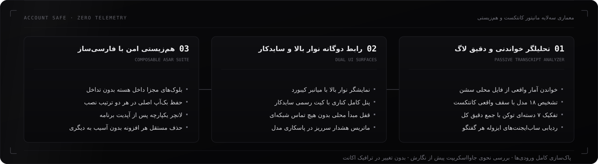

<p align="center">
  <a href="README.md">English</a> · <a href="README.zh-CN.md">简体中文</a> · <a href="README.ja.md">日本語</a> · <a href="README.es.md">Español</a> · <strong>فارسی</strong> · <a href="https://irdcode.github.io/antigravity-context-monitor/">مستندات وب</a>
</p>

<p align="center">
  
</p>

<div dir="rtl">

# مانیتور پنجره کانتکست آنتی‌گراویتی (Antigravity Context Monitor)

**نمایشگر لحظه‌ای ظرفیت Context Window سشن‌ها، تفکیک ۷ دسته‌ای مصرف توکن، وضعیت Prompt Cache، ردیابی Subagentهای ایزوله و محافظ تغییر مدل برای Google Antigravity Desktop.**

برخلاف هارنس‌های تک‌حلقه‌ای مثل Claude Code، محیط Antigravity در حالت `Orchestrator` بین مدل برنامه‌ریزی و اجرا جابه‌جا می‌شود، کارهای سنگین را در Subagentهای ایزوله (`invoke_subagent`) اجرا می‌کند و نمایشگر کانتکست را در ظاهر برنامه پنهان نگه داشته است. با این حال موتور برنامه در فایل محلی هر سشن (`transcript.jsonl`) آمار دقیق API را ثبت می‌کند و این افزونه بدون هیچ ارتباط شبکه‌ای همان داده را زنده نمایش می‌دهد.

</div>

<p align="center">
  
</p>

<div dir="rtl">

---

## قابلیت‌های کلیدی

- **محاسبه دقیق از روی آمار واقعی API مدل:** ظرفیت فعال هر گام مستقیماً از آخرین `PLANNER_RESPONSE` برابر با `input_tokens + cache_read_tokens + output_tokens` خوانده می‌شود.
- **پشتیبانی کامل از تمام ۱۸ مدل رسمی با سقف دقیق:**
  - **GPT-OSS 120B (`128k` / آستانه تمرکز `80k`)**
  - **Claude Opus & Sonnet 5.5 (`200k` / آستانه تمرکز `120k`)**
  - **Gemini 3.8 / Gemini 4 و `Orchestrator (Argon)` (`1M` / آستانه تمرکز `150k`)**
- **تشخیص حالت دو‌فازی (Plan / Execute) و محافظ پاسکاری مدل‌ها:** تغییر واقعی مدل فقط از `<USER_SETTINGS_CHANGE>` در پیام کاربر استخراج می‌شود (در برابر شباهت‌های متنی داخل خروجی ابزارها مصون است) و پیش از انتقال سشن سنگین به مدل‌های `128k` یا `200k` هشدار سرریز می‌دهد.
- **تفکیک ۷ دسته‌ای توکن با جمع دقیق ۱۰۰٪:** نمایش سهم `System & Rules`، `MCP Servers & Tools`، `Skills & Plugins`، `Files & Codebase`، `Terminal & Tasks`، `Chat Messages` و `Reasoning & Subagents` همراه با پشتیبانی از لاگ‌های چرخیده و `/compact`.
- **ردیابی کش و ساب‌ایجنت‌های ایزوله:** نمایش درصد Cache Hit، تعداد Cache Missها و میزان توکنی که توسط Subagentها از کانتکست اصلی خارج نگه داشته شده است.
- **نمایش دوگانه در رابط برنامه:**
  1. نوار وضعیت زنده در هدر چت با میانبر **`Alt+C`** (`⌥C` در مک)
  2. افزونه رسمی پنل کناری در `sidecar/` (نصب خودکار در `~/.gemini/config/plugins/context-monitor`)

---

## پیش‌نیازها و راه‌اندازی سریع (ویندوز)

- **Google Antigravity Desktop** (تأییدشده روی نسخه `2.32.1` در ویندوز)
- **Node.js نسخه ۲۰ یا بالاتر** (`winget install OpenJS.NodeJS.LTS`)

۱. روی فایل **`Launch-Antigravity-Context.bat`** دابل‌کلیک کنید تا `@electron/asar` (در صورت نیاز)، پچ نوار بالا و پلاگین Sidecar نصب شده و برنامه اجرا شود.
۲. داخل برنامه با **`Alt+C`** (یا دکمه کانتکست در نوار بالا) داشبورد لحظه‌ای باز می‌شود.
۳. برای پنل تمام‌قد کناری: در منوی سمت چپ وارد **Customizations ← Installed** شوید، **Context Monitor** را فعال کنید و در هر سشن از **⋮ ← Extensions ← Context Window** بازش کنید.

### فایل‌های همراه

| فایل | کاربرد |
| :--- | :--- |
| `Launch-Antigravity-Context.bat` | بررسی سلامت، اعمال خودکار پچ + همگام‌سازی Sidecar و اجرای `Antigravity.exe` |
| `Diagnose-Antigravity-Context.bat` | عیب‌یابی غیرمخرب (`doctor`) بدون تغییر فایل‌ها |
| `Restore-Antigravity-Context.bat` | حذف تمیز افزونه و بازگشت کامل به حالت اصلی |

---

## دستورات خط فرمان و توسعه

</div>

```bash
npm install --omit=dev
npm run doctor                 # بررسی سلامت بدون تغییر فایل
npm run patch                  # اعمال پچ روی app.asar و نصب پلاگین Sidecar
npm run sync                   # همگام‌سازی سریع کدهای Sidecar هنگام توسعه بدون دست‌زدن به app.asar
npm run analyze -- --json      # مشاهده خروجی تحلیلگر سشن در ترمینال
npm run restore                # حذف افزونه از app.asar و پلاگین
npm test                       # اجرای کامل تست‌های خودکار
```

<div dir="rtl">

---

## امنیت و اطمینان از سلامت اکانت

- **فقط خواندنی و کاملاً آفلاین:** هیچ درخواستی به اینترنت ارسال نمی‌شود و هیچ تغییری در پرامپت‌ها، هدرها یا ترافیک احراز هویت مدل‌ها ایجاد نمی‌گردد.
- **قفل مبدأ (`Origin Guard`):** اسکریپت تزریقی و ذخیره تنظیمات `~/.antigravity-context-monitor.json` منحصراً روی مبدأ محلی `127.0.0.1` اجرا و پاک‌سازی می‌شوند.

---

## لایسنس

منتشرشده تحت **لایسنس MIT** (`Copyright (c) 2026 Kiarash Javanbakht (IRDcode)`) — جزئیات در [LICENSE](LICENSE) و [THIRD_PARTY_NOTICES.md](THIRD_PARTY_NOTICES.md).

</div>
