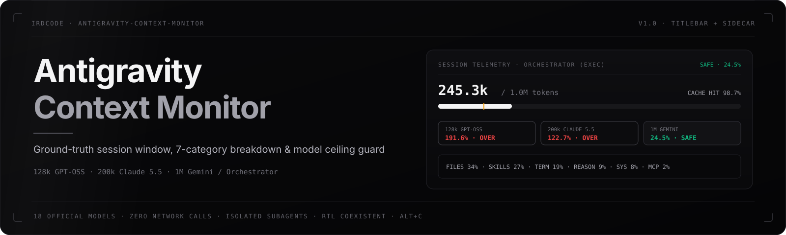
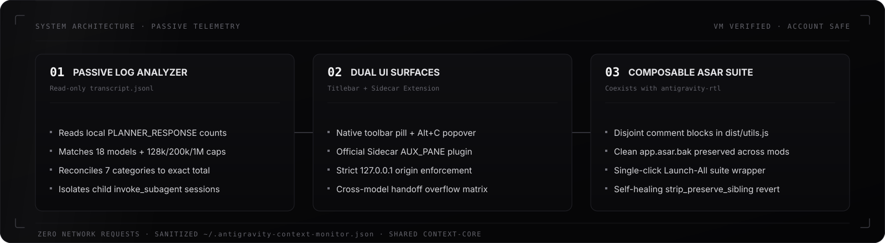

<p align="center">
  <a href="README.md">English</a> · <a href="README.zh-CN.md">简体中文</a> · <strong>日本語</strong> · <a href="README.es.md">Español</a> · <a href="README.fa.md">فارسی</a> · <a href="https://irdcode.github.io/antigravity-context-monitor/">Docs Page</a>
</p>

<p align="center">
  
</p>

# Antigravity Context Monitor

**Google Antigravity Desktop 向けのリアルタイムコンテキストウィンドウ監視、自動圧縮（`CHECKPOINT`）ガード、7カテゴリ別トークン内訳、Prompt Cache 可視化、Subagent 分離追跡、およびマルチモデル切り替えガード（`v2.0.0`）。**

Google Antigravity は `Orchestrator` モードで Planning / Execution モデルを切り替え、`invoke_subagent` により重い処理を子セッションへ分離する非同期アーキテクチャを採用しているため、UI 上に生のトークン残量が表示されません。しかしローカルのセッションログ（`~/.gemini/antigravity/brain/<convId>/.system_generated/logs/transcript.jsonl`）には正確な `input_tokens`・`cache_read_tokens`・`output_tokens` と圧縮チェックポイントが記録されています。

**`antigravity-context-monitor`** はネットワーク通信を一切行わずローカルログを読み取るだけで、アカウントの安全性を保ったまま高精度なコンテキスト監視を提供します。

<p align="center">
  
</p>

---

## v2.0.0 の主な機能

- **Antigravity Desktop `v2.34.0` 対応マルチアンカーパッチャー:** `loadHubWindowUrl`（`v2.34.0+`）および旧 `loadURL` フックに両対応し、`SHA-256` ペイロード検証により `--if-needed` で自動アップグレードします。
- **正確な API 実測 + 自動圧縮（`CHECKPOINT`）ガード:** 最新の `PLANNER_RESPONSE`（`input_tokens + cache_read_tokens + output_tokens`）から実使用量を算出。ブラウザチェックポイントや `step_index` 巻き戻し（`Rewinds`）と本物の自動圧縮（`Compacts`・履歴付き）を厳密に区別し、圧縮閾値（`1M` は `~500k`、`claude-1m_840k` は `840k`、`200k`/`128k` は `85%`）と警告スライダー（`30–95%`）を提供します。
- **36公式モデル内蔵 + 自動検出 + カスタム上限:** `GPT-OSS 120B/20B`（`128k`）、`Claude 5.5`（`200k` / `Max`・動的 `1M`/`840k`）、`Gemini 4 Neon/Carbon/Hydrogen/Argon`、`Gemini 3.x`、各種 `Orchestrator`（`1M`）を収録。将来のモデルもログと UI から自動検出し、設定パネルから個別の上限をカスタマイズできます。
- **カスタム Combobox・ネイティブ Light/Dark 同期・新規セッション対応:** ネイティブ `<select>` を廃止し検索可能な ARIA Combobox を採用。Antigravity 本体の Light / Dark テーマへ自動追従し、新規チャットでは過去ログへフォールバックせず `0 / <tier> · Ready` を表示します。
- **7カテゴリ別トークン内訳と2つの統一UI:** `System & Rules`、`MCP Servers & Tools`、`Skills & Plugins`、`Files & Codebase`、`Terminal & Tasks`、`Chat Messages`、`Reasoning & Subagents` へ合計 100% 配分。タイトルバー常駐メーター（**`Alt+C`** / `⌥C`）と公式 `sidecar_sdk` サイドパネルで同一UIキットを共有します。

---

## クイックスタート (Windows)

1. 本リポジトリをダウンロードし、**Node.js `>= 20.0.0`** が導入された環境で **`Launch-Antigravity-Context.bat`** を実行します。
2. **`Diagnose-Antigravity-Context.bat`** でヘルスチェック、**`Restore-Antigravity-Context.bat`** で純正状態への完全復元が可能です。

## CLI コマンド (Windows / macOS / Linux)

```bash
npm install --omit=dev
npm run doctor                 # 非破壊ヘルスチェック
npm run patch                  # app.asar パッチ適用 + Sidecar 同期
npm run sync                   # Sidecar ファイルの即時同期
npm run analyze -- --json      # CLI 上でコンテキスト解析結果を出力
npm run restore                # 純正状態へ復元
npm test                       # 全13自動テストの実行
```

## ライセンス

**MIT License** — [LICENSE](LICENSE) および [THIRD_PARTY_NOTICES.md](THIRD_PARTY_NOTICES.md) を参照してください。
