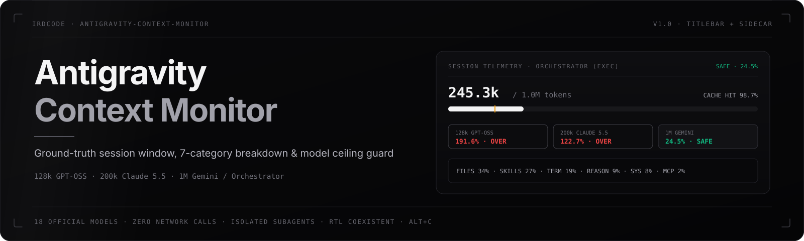
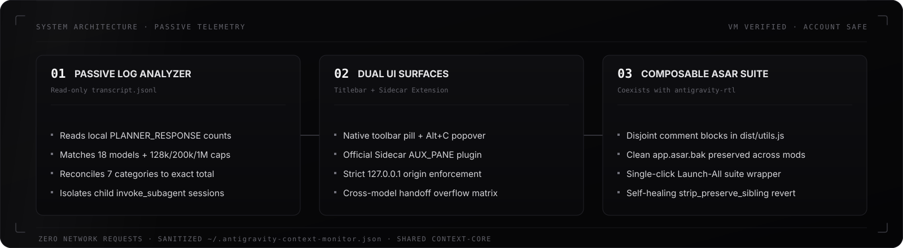

<p align="center">
  <strong>English</strong> · <a href="README.fa.md">فارسی (راهنمای فارسی)</a>
</p>

<p align="center">
  
</p>

# Antigravity Context Monitor

**Real-time session Context Window Monitor, 7-category token breakdown, prompt cache telemetry, isolated subagent tracker, and multi-model handoff guard for Google Antigravity Desktop.**

Unlike single-loop CLI harnesses (such as Claude Code), Google Antigravity isolates subagent sessions (`invoke_subagent`), switches between Planning and Execution models in `Orchestrator` mode, and hides raw token meters from the UI. However, Antigravity writes exact per-turn model token telemetry to local session logs (`~/.gemini/antigravity/brain/<convId>/.system_generated/logs/transcript.jsonl`).

`antigravity-context-monitor` reads those local files passively and delivers live context visibility across two native-styled surfaces — without touching network traffic, API keys, or prompts.

<p align="center">
  
</p>

---

## Key Capabilities

- **Exact Ground-Truth Token Math:** Computes live context usage directly from the latest `PLANNER_RESPONSE` step (`input_tokens + cache_read_tokens + output_tokens`), rather than rough character heuristics.
- **Full 18-Model Registry & True Context Ceilings:**
  - **GPT-OSS (`128k` ceiling / `80k` focus budget):** `gpt-oss-120b-medium`
  - **Claude 5.5 (`200k` ceiling / `120k` focus budget):** `claude-opus-5-5-{high,medium,low}`, `claude-sonnet-5-5-{high,medium,low}`
  - **Gemini 3.8 / 4 & Orchestrator (`1M` ceiling / `150k` focus budget):** `gemini-3.8-flash-*`, `gemini-4-argon-*`, `gemini-4-hydrogen-{low,medium,high,xhigh}`, and dual-phase `gemini-pro-orchestrator-g1-pro`
- **Multi-Model Handoff & Phase Guard:**
  - Tracks genuine `<USER_SETTINGS_CHANGE>` model transitions strictly inside `USER_INPUT` turns (immune to spoofed strings inside user prompts or tool outputs).
  - Detects `exit_plan_mode` / `[plan review]` phase shifts (`PLANNING ↔ EXECUTION`) and warns before handing a session over to a narrower tier (`128k` or `200k`) causes context overflow.
- **7-Category Allocation Breakdown:** Reconciles active tokens to **100% parity** with `activeTokens` across `System & Rules`, `MCP Servers & Tools`, `Skills & Plugins`, `Files & Codebase`, `Terminal & Tasks`, `Chat Messages`, and `Reasoning & Subagents` — including rotated log windows and `/compact` drops.
- **Prompt Cache & Subagent Isolation Telemetry:** Reports cache hit rate (`%`), fresh vs cached tokens, cache misses, and tokens safely offloaded into child `invoke_subagent` sessions.
- **Dual UI Delivery:**
  1. **Titlebar Live Meter + Popover (`Alt+C` / `⌥C`)**: Native monochrome toolbar pill and analytical drawer injected cleanly into `app.asar`.
  2. **Official Sidecar UI Extension (`sidecar/`)**: Dockable full-height Auxiliary Side Pane synced to `~/.gemini/config/plugins/context-monitor/`.

---

## Requirements

- **Google Antigravity Desktop** (verified on **Antigravity Desktop v2.32.1**, Windows 10/11 x64; CLI resolves standard macOS/Linux paths)
- **Node.js `>= 20.0.0`** (`winget install OpenJS.NodeJS.LTS` or [nodejs.org](https://nodejs.org/))
- First run installs the single dependency (`@electron/asar`) automatically if missing; runtime telemetry is **100% offline**.

---

## Quick Start (Windows)

1. Clone or download this repository to a permanent folder (e.g. `H:\A - codeproject\antigravity-context-monitor`).
2. Double-click **`Launch-Antigravity-Context.bat`**:
   - Installs `@electron/asar` on first run if needed.
   - Backs up untouched `app.asar` to `app.asar.bak` (or preserves an existing clean `.bak` created by `antigravity-persian-rtl`).
   - Patches the titlebar monitor, syncs the Sidecar plugin to `~/.gemini/config/plugins/context-monitor`, and launches `Antigravity.exe`.
3. Inside Antigravity:
   - Press **`Alt+C`** (`⌥C` on macOS) or click the **Context Monitor** meter pill in the top bar.
   - To also use the full-height side panel: open **Customizations → Installed**, enable **Context Monitor**, and open **⋮ → Extensions → Context Window** inside any conversation.

### Included Windows Batch Tools

| File | Purpose |
| :--- | :--- |
| `Launch-Antigravity-Context.bat` | Verifies ASAR state, applies/refreshes patch + Sidecar sync if needed, and starts `Antigravity.exe` |
| `Diagnose-Antigravity-Context.bat` | Non-destructive diagnostics (`doctor`) checking Node, `app.asar`, Sidecar plugin sync, `.bak` health, and locks |
| `Restore-Antigravity-Context.bat` | Cleanly removes Context Monitor (preserves sibling `antigravity-persian-rtl` if active, or restores exact `.bak` when standalone) |

---

## Companion Extension (`antigravity-persian-rtl`)

If you also use Persian, Arabic, Kurdish, Urdu, or Pashto inside Google Antigravity Desktop, check out the companion project:

- **[antigravity-persian-rtl](https://github.com/IRDcode/antigravity-persian-rtl)** — Hardened offline RTL layout engine (`unicode-bidi: isolate`), bundled `Vazirmatn` font, and `Alt+R` toggle for Antigravity Desktop.

Both extensions share a **composable sibling ASAR protocol**:
- They write strictly disjoint blocks into `dist/utils.js` in any installation order (`RTL -> Context` or `Context -> RTL`).
- Removing one preserves the other (`strip_preserve_sibling`) and keeps the clean `app.asar.bak` intact until the final mod is removed.
- Placing both folders side-by-side lets a single suite wrapper (`Launch-All-Antigravity-Mods.bat`) re-apply every installed Antigravity mod together in one click after app updates.

---

## CLI Usage (Windows, macOS & Linux)

```bash
npm install --omit=dev
npm run doctor                 # Non-destructive health check
npm run patch                  # Apply ASAR patch + sync Sidecar plugin
node src/patcher.mjs patch --if-needed
npm run sync                   # Sync src/context-core.cjs and Sidecar files without touching app.asar
npm run analyze -- --json      # Inspect active/recent session telemetry in CLI
npm run status                 # Inspect patch, Sidecar, and backup state
npm run restore                # Remove Context Monitor cleanly
```

---

## Security & Account-Safety Guarantees

| Security Control | Implementation |
| :--- | :--- |
| **Account-Safe Passive Read** | Reads local `transcript.jsonl` files strictly read-only; never intercepts API requests, headers, auth tokens, or prompts |
| **Origin Allowlist** | Both `dom-ready` injection and `console-message` handlers strictly require `^https?://127\.0\.0\.1:\d+` |
| **Config Sanitization** | Writes to `~/.antigravity-context-monitor.json` sanitize `modelOverride`, `selectedConvId`, `compactWarnPct` (`30..95`), and `showInTitlebar` |
| **Zero Network Calls** | Zero `fetch`, zero telemetry, zero `shell.openExternal` inside injected runtime |
| **Safe Scope & ASAR Packing** | Isolates `context-core.cjs` inside a local closure so outer `dist/utils.js` `module.exports` is never clobbered; compiles inside `node:vm` before packing |

---

## Development & Verification

```bash
npm test
```

Runs `test/patcher.test.mjs`, covering all 18 model ceilings, spoofed tool-output immunity, Plan/Execute transitions, rotated transcripts, `/compact` recovery, subagent isolation, `127.0.0.1` security guards, bidirectional coexistence with `antigravity-persian-rtl`, and real `app.asar` `.unpacked` preservation.

---

<div dir="rtl">

## خلاصه فارسی

**مانیتور پنجره کانتکست آنتی‌گراویتی (`antigravity-context-monitor`)** بدون نیاز به اتصال اینترنت و بدون دستکاری درخواست‌های اکانت، از روی لاگ‌های محلی هر سشن (`transcript.jsonl`) موارد زیر را زنده نمایش می‌دهد:

- حجم دقیق کانتکست اشغال‌شده و باقی‌مانده برای هر ۱۸ مدل رسمی با سقف واقعی (`128k` / `200k` / `1M`)
- تفکیک ۷ دسته‌ای مصرف توکن (`System`، `MCP`، `Skills`، `Files`، `Terminal`، `Messages` و `Reasoning & Subagents`)
- هشدار سرریز هنگام پاسکاری مدل‌ها در حالت `Orchestrator` یا جابه‌جایی مدل در میانه سشن
- هم‌زیستی کامل با افزونه مکمل **[antigravity-persian-rtl](https://github.com/IRDcode/antigravity-persian-rtl)** روی یک فایل `app.asar` — راهنمای کامل فارسی: **[README.fa.md](README.fa.md)**

</div>

---

## License

MIT — `Copyright (c) 2026 Kiarash Javanbakht (IRDcode)`. See [LICENSE](LICENSE) and [THIRD_PARTY_NOTICES.md](THIRD_PARTY_NOTICES.md).
