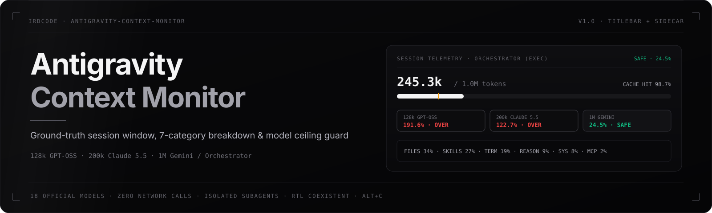
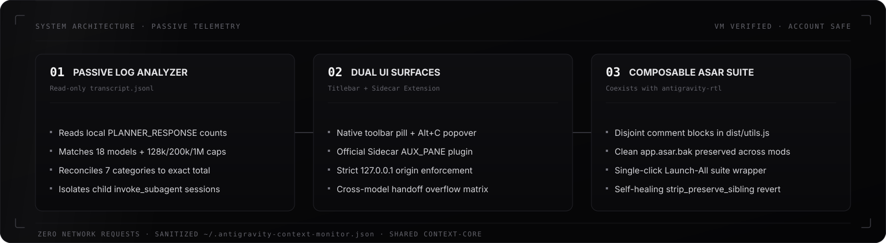

<p align="center">
  <a href="README.md">English</a> · <strong>简体中文</strong> · <a href="README.ja.md">日本語</a> · <a href="README.es.md">Español</a> · <a href="README.fa.md">فارسی</a> · <a href="https://irdcode.github.io/antigravity-context-monitor/">Docs Page</a>
</p>

<p align="center">
  
</p>

# Antigravity Context Monitor

**适用于 Google Antigravity Desktop 的实时会话上下文窗口监控器、自动压缩（`CHECKPOINT`）预警守卫、7 类 Token 占用明细、Prompt Cache 命中率统计、子智能体隔离追踪与多模型切换防溢出守卫（`v2.0.0`）。**

不同于 Claude Code 等单循环终端工具，Google Antigravity 在 `Orchestrator` 模式下会在规划模型与执行模型之间切换，并通过 `invoke_subagent` 在独立子会话中执行检索和浏览器任务，同时在界面上隐藏了底层 Token 计数器。但 Antigravity 会在本地会话日志（`~/.gemini/antigravity/brain/<convId>/.system_generated/logs/transcript.jsonl`）中精确记录每一步的 `input_tokens`、`cache_read_tokens`、`output_tokens` 与压缩检查点。

**`antigravity-context-monitor`** 以完全只读、零网络请求的方式读取这些本地日志，在不篡改请求、不接触账号令牌的前提下提供原生的上下文监控视图。

<p align="center">
  
</p>

---

## v2.0.0 核心特性

- **已验证适配 Antigravity Desktop `v2.34.0`（多锚点兼容）：** 优先挂钩 `loadHubWindowUrl`（`v2.34.0+`）并向后兼容 `v2.32.x`–`v2.33.x`，内置 `SHA-256` 载荷指纹校验以支持 `--if-needed` 自动平滑升级。
- **真实 API Token 计数 + 自动压缩守卫（`CHECKPOINT`）：** 直接读取最新 `PLANNER_RESPONSE` 的 `input_tokens + cache_read_tokens + output_tokens`；精准区分真实会话压缩与浏览器检查点，独立统计 `Compacts`（含压缩前后历史）与 `Rewinds`（`step_index` 回退重试），支持自适应压缩阈值（`1M` 默认 `~500k`、`claude-1m_840k` 为 `840k`、`200k`/`128k` 为 `85%`）与可调告警比例（`30–95%`）。
- **内置 36 个官方模型 + 未来模型自动发现 + 自定义上限：**
  - **GPT-OSS（`128k` 上限 / `80k` 注意力甜点）：** `gpt-oss-120b-medium`、`gpt-oss-20b`
  - **Claude 5.5（`200k` 上限 / `120k` 注意力甜点，动态识别 `1M`/`840k` 变体）：** `claude-opus-5-5-{max,high,medium,low}`、`claude-sonnet-5-5-{max,high,medium,low}`
  - **Gemini 4（`Neon` / `Carbon` / `Hydrogen` / `Argon`）、Gemini 3.x 与 Orchestrator（`1M` 上限 / `~500k` 自动压缩 / `150k` 甜点）**
  - 自动从会话日志与实时界面发现新模型，并可在折叠式 **Settings** 中配置任意模型的自定义上限。
- **统一 UI 组件库、无障碍自定义 Combobox 与原生浅色/深色主题同步：** 彻底替换原生 `<select>`（修复 Windows Electron 白色下拉框问题），支持搜索过滤与键盘导航，实时同步宿主浅色/深色主题与 CSS 变量；新建空会话干净显示 `0 / <tier> · Ready` 而不误用旧会话数据。
- **7 类 Token 构成占比（严格对齐 100% 总量）：** 拆分展示 `System & Rules`、`MCP Servers & Tools`、`Skills & Plugins`、`Files & Codebase`、`Terminal & Tasks`、`Chat Messages` 与 `Reasoning & Subagents`。
- **双端原生展示：** 顶部标题栏实时胶囊 + 单列抽屉面板（快捷键 **`Alt+C`** / `⌥C`）以及官方 `sidecar_sdk` 侧边扩展面板。

---

## 快速开始（Windows）

1. 下载并解压到固定目录（例如 `C:\Tools\antigravity-context-monitor`），需预先安装 **Node.js `>= 20.0.0`**。
2. 双击 **`Launch-Antigravity-Context.bat`**：首次运行自动安装 `@electron/asar`、创建未修改备份 `app.asar.bak`、注入或升级监控面板并同步 Sidecar 插件至 `~/.gemini/config/plugins/context-monitor`，随后启动 `Antigravity.exe`。
3. 官方更新覆盖 `app.asar` 后，再次通过 `Launch-Antigravity-Context.bat` 启动即可自动重新应用。
4. 使用 **`Diagnose-Antigravity-Context.bat`** 进行无损健康诊断，使用 **`Restore-Antigravity-Context.bat`** 一键还原官方原版。

---

## 命令行用法（Windows / macOS / Linux）

```bash
npm install --omit=dev
npm run doctor                 # 无损健康检查
npm run patch                  # 应用补丁并同步 Sidecar 插件
npm run sync                   # 仅同步 Sidecar 开发文件，不修改 app.asar
npm run analyze -- --json      # 在终端输出当前会话上下文 JSON 报告
npm run restore                # 安全还原 app.asar
npm test                       # 运行完整 13 组测试套件
```

## 开源许可

基于 **MIT License** 开源 — 详见 [LICENSE](LICENSE) 与 [THIRD_PARTY_NOTICES.md](THIRD_PARTY_NOTICES.md)。
